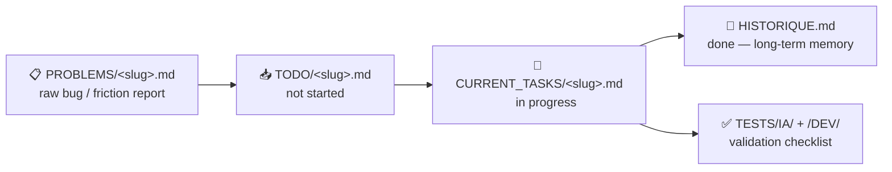

<div align="center">


# claude-crew: stop parallel Claude Code sessions from editing the same files

claude-crew is a Claude Code plugin that keeps parallel sessions from editing the same files: each task batch runs in its own git worktree, and a PreToolUse hook rejects writes into a zone locked by another session. It also tracks tasks as markdown files that move between folders (TODO, CURRENT_TASKS, HISTORIQUE), so a new session can see what is done and in progress, and you can install it with [three commands](#-quick-start), with no server or database.

[](./LICENSE)
[](#-whats-in-the-box)
[](https://github.com/anthropics/claude-code)

**[Quick start](#-quick-start)** · **[How it works](#-how-it-works)** ·
**[Batching](#-the-actual-differentiator-batching)** ·
**[What's in the box](#-whats-in-the-box)** · **[Is this for you?](#-not-for-you-if)**

</div>

---

> [!TIP]
> Claude Code does not carry task state from one session to the next unless you
> write it down. Run two instances on the same repo and nothing warns you when
> they edit the same files at the same time. `claude-crew` addresses both with
> markdown files and two stdlib-only Python hooks. No server, no DB (the web
> dashboard is optional).
>
> **Three commands to install, nothing to host.**

> [!NOTE]
> **Not to be confused with.** Other, unrelated projects use the name claude-crew:
> - [d-kimuson/claude-crew](https://github.com/d-kimuson/claude-crew): a CLI tool for Claude Desktop.
> - [@nbonamy/claude-crew](https://www.npmjs.com/package/@nbonamy/claude-crew) (npm): agent-to-agent communication over MCP.
> - [matthewrsj/claude-crew](https://github.com/matthewrsj/claude-crew): review and test sub-agents.
>
> This repository, `Nakken13/claude-crew`, is a Claude Code plugin for task lifecycle and collision prevention between parallel sessions. It does not use MCP. Independent project, not affiliated with Anthropic or with the projects above.

<br>

## 🧩 The problem

| | |
|---|---|
| 🧠 **Session amnesia** | Every new Claude Code session starts blind: what's done, what's half-done, why a decision was made — gone unless you paste it back in yourself. |
| 💥 **Multi-agent collisions** | Parallelizing Claude Code (one instance per workstream) is the obvious way to go faster. It's also the fastest way to get two agents editing the same file at the same time, silently. |

<br>

## ⚙️ How it works

A task is a file. Its state *is* which folder it's in — no status field to
forget to update, `git mv` is the state transition:



A file is never in two folders at once. `git log --follow` on a task file is
its entire history.

<br>

## 🎯 The actual differentiator: batching

On top of the folder layout, `claude-crew` tracks *which files each task
touches* (its "zone"), groups tasks that share a zone into the same batch,
and **blocks** — not just flags — a write when a batch's zone overlaps an
**active** batch it doesn't belong to. Two layers, not one:

- **Layer 1 — physical isolation.** Each active batch runs in its own `git
  worktree` (`../<repo>-batch-<slug>/`, sibling of the main checkout) on its
  own branch (`crew/batch-<slug>`). Two Claude Code instances on two
  different batches work in different working trees, so they do not share
  files on disk (this assumes each session is started in its own batch
  worktree).
- **Layer 2 — a blocking gate.** A `PreToolUse` hook intercepts
  `Edit`/`Write`/`MultiEdit` calls and mutating `Bash` commands matching
  `rm`/`mv`/`cp`/output redirection/`git mv`, and **rejects them (`exit 2`)
  before they run** if the path they touch falls under a `Zone:` already
  locked by a *different* session. The lock itself is registered
  preventively at the moment a task moves `TODO → CURRENT_TASKS` — including
  when that `git mv` is run from inside a batch worktree rather than the
  main checkout — written under a mutex with an atomic file replace, so two
  sessions racing to claim the same batch can't both win.

The `PreToolUse` hook only spawns Python when it can matter: a shell pre-filter
skips it unless `crew/CLAUDE_CONTEXT/.gate_armed` exists (maintained by the lock
writer, present only while ≥ 2 sessions hold locks) or the `Bash` call is a claim
(`git mv` into `CURRENT_TASKS/`, `crew-resume:`), so solo sessions skip the
Python start-up cost on `Edit`/`Write`. Set `CREW_HOOK_PROFILE=minimal` to disable the
`PreToolUse` gate entirely (`Stop`/`SessionEnd` keep syncing indexes and locks).

A `SessionStart` hook (`startup|resume|compact`) injects a read-only crew digest (≤ 2000 chars:
active/paused tasks with `n/m` checkboxes, active batches, other sessions' locks, last 3
`HISTORIQUE.md` entries) so a resume or compaction doesn't re-read `crew/` by hand. Set
`CREW_SESSION_DIGEST=off` to disable it.

A `Stop` hook still regenerates `INDEX.md`/`BATCH_LOCKS.md` and re-checks
zone overlaps every turn, but now purely as a retroactive fallback (a
`git mv` run outside a tracked `Bash` call, or the `PreToolUse` gate getting
bypassed) — it's no longer the only thing standing between two agents and
the same file.

> [!IMPORTANT]
> You catch the collision **before** you point a second Claude Code instance
> at the same code — and if you don't, the write is refused when the gate is
> armed and the call matches a guarded pattern.

```
🟢 Batch A — Zone: frontend/checkout/**   [worktree ../repo-batch-a/, branch crew/batch-a]
🟢 Batch B — Zone: backend/payments/**    [worktree ../repo-batch-b/, branch crew/batch-b]
🔴 Batch C — Zone: frontend/checkout/**   <-- overlaps Batch A, write blocked (exit 2) before it happens
```

This is the part that matters once you're running more than one agent: the
folder lifecycle works on its own, and the worktree isolation plus the
blocking gate is what keeps parallel Claude Code instances from stepping on
each other's files.

<br>

## 📦 What's in the box

| Piece | What it does |
|---|---|
| 🗂️ `crew/` | The task lifecycle folders (`PROBLEMS`/`TODO`/`CURRENT_TASKS`/`TESTS`/`CLAUDE_CONTEXT`/`ICEBOX`) |
| 🌳 Per-batch `git worktree` | Physical isolation — each active batch gets its own checkout (`../<repo>-batch-<slug>/`) and branch (`crew/batch-<slug>`), so parallel Claude Code instances do not share a working tree |
| 🪝 `crew_hook.py` | Two hooks in one file: `PreToolUse` blocks (`exit 2`) any `Edit`/`Write`/`MultiEdit`/mutating `Bash` into a zone locked by another session, and registers that lock preventively on `git mv`; `Stop` regenerates `INDEX.md`/`BATCH_LOCKS.md` and re-checks overlaps as a fallback |
| 🪝 `spec_to_task_hook.py` | Runs on file writes — keeps specs and tasks in sync |
| ⚡ `/crew-init` | Bootstraps the whole scaffold onto a project, resolves every `<placeholder>`, fails loud if one is left unresolved |
| ⚡ `/crew-new-task` `/crew-close-task` `/crew-status` | Run the lifecycle + batching instead of doing it by hand every time |
| 🎭 `.claude/agents/ceo.md` `manager.md` `comms.md` `architect.md` `designer.md` `legal.md` `social.md` `seo.md` | Subagent personas routed by decision type — business/priority calls, task breakdown, user-facing copy, structural tech choices, UX/retention/spec decisions, legal exposure, organic social distribution, and search/store/AI-answer discoverability don't get answered by the same voice that writes your diff |
| 📖 `CLAUDE.md` / `AGENTS.md` | Skill routing + context-efficiency rules (no reading 2000-line files whole) wired into Claude Code from day one |

Everything is plain markdown + JSON state — readable, greppable, diffable in
a normal PR review. No hosted board, no account, nothing to sync.

<br>

## 🚀 Quick start

Pick one — all three end up in the same place: `/crew-init` running against
your project.

### 🔌 Option A — Install via marketplace (recommended)

```
/plugin marketplace add Nakken13/claude-crew
/plugin install claude-crew@claude-crew
/crew-init
```

No cloning, no manual file copying — skills, agents, and hooks run straight
from the installed plugin.

### 🤖 Option B — Ask Claude to install it

Paste this into Claude Code, in the project you want to set up:

```
Install the claude-crew plugin (marketplace add Nakken13/claude-crew, then
install claude-crew@claude-crew), then run /crew-init here.
```

Claude runs the marketplace add + install for you, then bootstraps the
project the same way as Option A.

### 📋 Option C — Manual clone (no plugin system)

```bash
git clone https://github.com/Nakken13/claude-crew.git
cp -r claude-crew/{CLAUDE.md,AGENTS.md,PRODUCT.md,CONTRIBUTING.md,SECURITY.md,crew,.claude} your-project/
```

Open `your-project` in Claude Code and run `/crew-init`. Use this if you
don't want a marketplace dependency — everything (skills, agents, hooks)
gets copied straight into the project instead of running from an installed
plugin.

<br>

Whichever option you pick, `/crew-init` detects your stack, resolves every
`<placeholder>` with the real repo info, and fails loud
(`check_placeholders.py`) until nothing is left unfilled. Full step-by-step
in [`CLAUDE.md`](./CLAUDE.md).

Once it's running, four commands drive day-to-day work:

- ✨ `/crew-new-task` — create a task, auto-categorized into a batch
- ✅ `/crew-close-task` — close a finished task: checks, history, tests moved out
- 📊 `/crew-status` — read-only report: active batches, overlaps, orphaned tasks
- 🔄 `/crew-update` — pull engine-file changes into an already-bootstrapped project

<br>

## 📊 Optional: local web dashboard

A read/write web UI over your `crew/` folders (tasks, batches, tests). Local
only (`127.0.0.1`), optional — the hooks work fine without it.

**From Claude Code:** run `/crew-dashboard`.

**Standalone (Windows, no Claude session):** double-click `crew/dashboard.bat`,
or from the repo root:

```bat
crew\dashboard.bat
```

`crew/dashboard.bat` is copied into every project by `/crew-init` (and kept
current by `/crew-update`). It finds the server in this order: `%CREW_DASHBOARD_DIR%`
(manual override), `scripts/dashboard/` in the repo (claude-crew itself), then the
newest installed plugin under `%USERPROFILE%\.claude\plugins\cache\claude-crew\`.
So the plugin must be installed for it to work in other projects.

First run creates an isolated venv (`.dashboard-venv/`) and installs the
dashboard requirements; later runs reuse it. Needs Python 3 on the `PATH`
(`py` or `python`).

Then open the URL printed in the terminal — default `http://127.0.0.1:8943`;
if that port is taken, a free one is picked and printed instead. `Ctrl+C` in
the terminal stops the server.

<br>

## 🔄 Updating an existing project

Already bootstrapped? `/crew-update` pulls in engine-file changes (fixes,
new rules, new skills) without ever touching your `crew/` task data.

- **Plugin install (Option A/B)** — skills, agents, and hooks already run
  from `${CLAUDE_PLUGIN_ROOT}`, so `/plugin update claude-crew` covers those;
  `/crew-update` only checks `CLAUDE.md`/`AGENTS.md`/`PRODUCT.md`/
  `CONTRIBUTING.md`/`SECURITY.md`/`check_placeholders.py`.
- **Manual clone (Option C)** — `/crew-update` also checks `crew_hook.py`,
  `spec_to_task_hook.py`, and the local `.claude/skills/crew-*`/
  `.claude/agents/*` copies.

It never touches `crew/TODO/`, `crew/CURRENT_TASKS/`, `crew/PROBLEMS/`,
`crew/ICEBOX/`, `crew/TESTS/`, or `crew/CLAUDE_CONTEXT/HISTORIQUE.md`, and it
never silently overwrites a file you've personalized. Each engine file gets
one of four statuses before anything is written:

- `up_to_date` — nothing to do.
- `new` — added upstream, missing locally → created.
- `apply` — unchanged locally since the last update → safe to refresh.
- `conflict` — you've edited it since → shown as a diff, never overwritten
  without you saying so.

<br>

## 🎓 Tutorial: update claude-crew

**Plugin install (Option A/B)**

1. Update the plugin itself (skills, agents, hooks):
   ```
   /plugin update claude-crew
   ```
2. Restart Claude Code so the new version is loaded.
3. In each bootstrapped project, sync the project-level files:
   ```
   /crew-update
   ```
4. Review the report: `new` and `apply` are written for you; for every
   `conflict`, check the diff and say whether to overwrite or keep your version.

**Manual clone (Option C)**

1. Pull the latest scaffold in your clone of claude-crew:
   ```bash
   git pull
   ```
2. In each bootstrapped project, run `/crew-update` — it also refreshes
   `crew_hook.py`, `spec_to_task_hook.py`, and the local `.claude/skills/crew-*`/
   `.claude/agents/*` copies.
3. Review the report as above.

Your `crew/` task data is never modified. See
[Updating an existing project](#-updating-an-existing-project) for what each
status means.

<br>

## ❓ FAQ

### How do I stop two Claude Code sessions from editing the same file?

Run each batch in its own git worktree (`crew/batch-<slug>` branch). When a
task moves from `TODO` to `CURRENT_TASKS`, the session locks the batch's
`Zone:`, and the `PreToolUse` hook rejects (`exit 2`) `Edit`/`Write`/`MultiEdit`
and mutating `Bash` commands (`rm`/`mv`/`cp`/redirections/`git mv`) from another
session that touch it. The gate is armed only while at least two sessions hold
locks, and `CREW_HOOK_PROFILE=minimal` turns it off.

### How do I keep task state between Claude Code sessions?

A task is a markdown file and its state is the folder it is in (`TODO`,
`CURRENT_TASKS`); finished work goes to `crew/CLAUDE_CONTEXT/HISTORIQUE.md`. A
`SessionStart` hook (`startup|resume|compact`) injects a digest of up to 2000
characters: active and paused tasks, active batches, other sessions' locks, the
last 3 history entries. `CREW_SESSION_DIGEST=off` disables it.

### Does it need a server or a database?

No. The hooks are stdlib-only Python scripts and the state is markdown and JSON
files in your repo. The local web dashboard is optional: it listens on
`127.0.0.1` and installs its own requirements in a venv on first run.

<br>

## 🙅 Not for you if

> [!NOTE]
> - You're solo, one Claude Code session, small script — this is overhead you
>   don't need yet.
> - You want a hosted task board with a UI — this is deliberately local-first,
>   files-only, no service to run.

<br>

## 🤝 Contributing

Issues and PRs welcome — see [`CONTRIBUTING.md`](./CONTRIBUTING.md). If
`claude-crew` saves you a merge conflict, a ⭐ helps other people find it.

[](https://github.com/Nakken13/claude-crew)

## 📄 License

MIT — see [`LICENSE`](./LICENSE).
