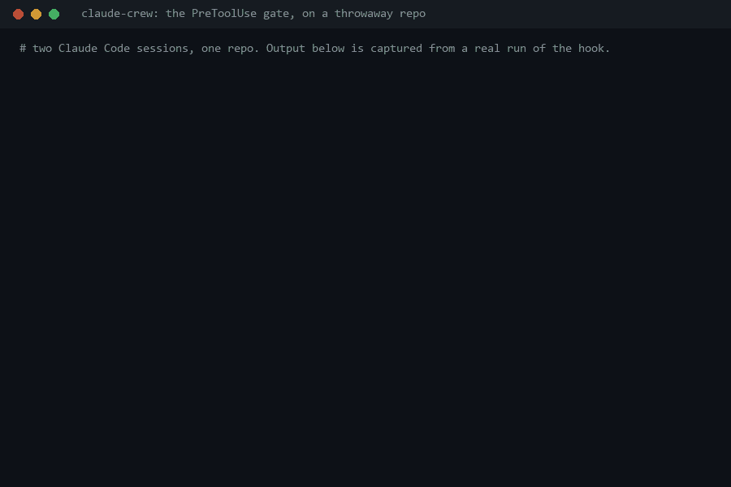
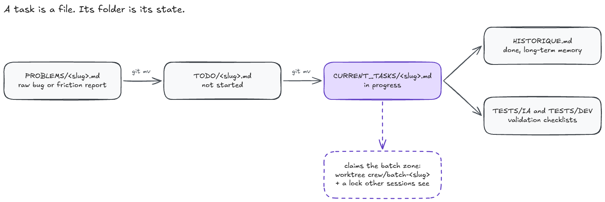

<div align="center">


# claude-crew

**Stop parallel Claude Code sessions from editing the same files.**

[](./LICENSE)
[](#whats-in-the-box)
[](https://github.com/anthropics/claude-code)

[Quick start](#quick-start) · [How it works](#how-it-works) · [Batching](#batching) · [Who it's for](#who-its-for) · [What's in the box](#whats-in-the-box) · [FAQ](#faq)

</div>

---

claude-crew is a Claude Code plugin. Each task batch runs in its own git worktree, and a `PreToolUse` hook rejects writes into a zone that another session has locked. Tasks are markdown files that move between folders (`TODO`, `CURRENT_TASKS`, `HISTORIQUE`), so a new session can read what is done and what is in progress. No server, no database.

```
/plugin marketplace add Nakken13/claude-crew
/plugin install claude-crew@claude-crew
/crew-init
```

<p align="center"></p>

Two sessions, two batches. Session B works in its own zone, then tries to edit and delete a file in session A's zone, and the hook blocks both. The animation replays the captured output of the real `PreToolUse` command from `hooks/hooks.json`, run against a throwaway repo. The gate messages are in French, as the hook prints them.

## The problem

Task state disappears between sessions. A new Claude Code session does not know what is done, what is half done, or why you made a decision, unless you paste it back in.

Parallel sessions collide. Running one instance per workstream is the obvious way to go faster, and nothing warns you when two of them edit the same file.

## Who it's for

Use it if:

- you run more than one Claude Code session on the same repo, one per workstream;
- you want tasks, decisions and test checklists to live in the repo as files you can diff and review in a PR;
- you want a new session to start knowing what is in progress, without you pasting context.

Skip it if:

- you work solo, with one Claude Code session on a small script. This is overhead you do not need yet;
- you want a hosted task board with a UI. claude-crew is local-first and files-only, with no service to run.

## How it works

A task is a file. Its folder is its state. There is no status field to forget to update, and `git mv` is the transition.

<picture>
  <source media="(prefers-color-scheme: dark)" srcset="./media/how-it-works-dark.png">
  
</picture>

A file is never in two folders at once, so `git log --follow` on a task file is its whole history. The diagram source is [`media/how-it-works.excalidraw`](./media/how-it-works.excalidraw); open it on [excalidraw.com](https://excalidraw.com) to edit it.

## Batching

claude-crew records which files each task touches (its zone) and puts tasks that share a zone in the same batch. When a batch's zone overlaps an active batch it does not belong to, the write is blocked, not just reported. It works in two layers.

**Layer 1, isolation.** Each active batch runs in its own `git worktree` (`../<repo>-batch-<slug>/`, next to the main checkout) on its own branch (`crew/batch-<slug>`). Two Claude Code instances on two different batches work in different working trees, so they do not share files on disk. This assumes each session is started in its own batch worktree.

**Layer 2, the gate.** A `PreToolUse` hook intercepts `Edit`, `Write` and `MultiEdit` calls, plus `Bash` commands that match `rm`, `mv`, `cp`, output redirection or `git mv`. It rejects them (`exit 2`) before they run if the path they touch falls under a `Zone:` already locked by a different session. The lock is registered when a task moves from `TODO` to `CURRENT_TASKS`, including when that `git mv` runs inside a batch worktree. It is written under a mutex with an atomic file replace, so two sessions racing for the same batch cannot both win.

The gate is cheap on solo sessions. A shell pre-filter skips Python unless `crew/CLAUDE_CONTEXT/.gate_armed` exists (present only while at least two sessions hold locks) or the `Bash` call is a claim (`git mv` into `CURRENT_TASKS/`, `crew-resume:`). Set `CREW_HOOK_PROFILE=minimal` to turn the `PreToolUse` gate off; the `Stop` and `SessionEnd` hooks keep syncing indexes and locks.

Two more hooks support it:

- `SessionStart` (`startup`, `resume`, `compact`) injects a read-only digest of up to 2000 characters: active and paused tasks with `n/m` checkboxes, active batches, other sessions' locks, and the last 3 `HISTORIQUE.md` entries. A resume or a compaction does not have to re-read `crew/` by hand. `CREW_SESSION_DIGEST=off` disables it.
- `Stop` regenerates `INDEX.md` and `BATCH_LOCKS.md` and re-checks zone overlaps every turn. It is a fallback for a `git mv` run outside a tracked `Bash` call or a gate that got bypassed.

The gate has limits. `Bash` detection is pattern-based, so a mutating command outside those patterns passes. If you point a second instance at the same code while the gate is not armed, the write is not refused. Check the overlap before you start the second session.

## What's in the box

| Piece | What it does |
|---|---|
| `crew/` | The task lifecycle folders: `PROBLEMS`, `TODO`, `CURRENT_TASKS`, `TESTS`, `CLAUDE_CONTEXT`, `ICEBOX` |
| Per-batch `git worktree` | One checkout (`../<repo>-batch-<slug>/`) and one branch (`crew/batch-<slug>`) per active batch |
| `crew_hook.py` | `PreToolUse` blocks writes into a zone locked by another session and registers the lock on `git mv`. `Stop` regenerates `INDEX.md` and `BATCH_LOCKS.md` and re-checks overlaps as a fallback |
| `spec_to_task_hook.py` | Runs on file writes and keeps specs and tasks in sync |
| `/crew-init` | Bootstraps the scaffold onto a project, resolves every `<placeholder>`, and fails if one is left unresolved |
| `/crew-new-task`, `/crew-close-task`, `/crew-status` | Run the lifecycle and the batching so you do not do it by hand |
| `.claude/agents/` | Eight subagent personas: `ceo`, `manager`, `comms`, `architect`, `designer`, `legal`, `social`, `seo`. Each covers one kind of decision (priority, task breakdown, copy, technical choices, UX, legal risk, social distribution, search visibility), so the voice that writes your diff does not also answer those |
| `CLAUDE.md`, `AGENTS.md` | Skill routing and context rules (no reading a 2000-line file whole), wired into Claude Code from the first session |

Everything is markdown and JSON. You can read it, grep it, and review it in a normal PR. There is no hosted board, no account, and nothing to sync.

## Quick start

Pick one. All three end with `/crew-init` running against your project.

### Option A: install from the marketplace (recommended)

```
/plugin marketplace add Nakken13/claude-crew
/plugin install claude-crew@claude-crew
/crew-init
```

Nothing to clone or copy. Skills, agents and hooks run from the installed plugin.

### Option B: ask Claude to install it

Paste this into Claude Code, in the project you want to set up:

```
Install the claude-crew plugin (marketplace add Nakken13/claude-crew, then
install claude-crew@claude-crew), then run /crew-init here.
```

Claude runs the marketplace add and the install, then bootstraps the project the same way as Option A.

### Option C: manual clone (no plugin system)

```bash
git clone https://github.com/Nakken13/claude-crew.git
cp -r claude-crew/{CLAUDE.md,AGENTS.md,PRODUCT.md,CONTRIBUTING.md,SECURITY.md,crew,.claude} your-project/
```

Open `your-project` in Claude Code and run `/crew-init`. Use this if you do not want a marketplace dependency. Skills, agents and hooks are copied into the project instead of running from an installed plugin.

Whichever option you pick, `/crew-init` detects your stack, fills every `<placeholder>` with the real repo information, and keeps failing (`check_placeholders.py`) until none is left. The full steps are in [`CLAUDE.md`](./CLAUDE.md).

### Your first task

After `/crew-init`, describe a task in plain language and say where it goes:

```text
/crew-new-task Add retry with backoff to failed card charges. It touches backend/payments/ and its tests. Put it in the backlog.
```

claude-crew writes the task file with checkable actions, files it in a batch with its zone, and lists it in `crew/TODO/`. Create a second task the same way for another area, for example `frontend/checkout/`. Then run this in two terminals:

```text
/crew-start
```

Each session picks a batch no other session holds and works in that batch's worktree. When the code is done, `/crew-close-task` checks the boxes, logs the work in `HISTORIQUE.md` and moves the test checklists out.

### Day-to-day commands

- `/crew-new-task` creates a task and files it in a batch.
- `/crew-start` resumes the task in progress, or starts a batch no other session holds.
- `/crew-close-task` closes a finished task: checks, history, tests moved out.
- `/crew-status` prints a read-only report of active batches, overlaps and orphaned tasks.
- `/crew-update` pulls engine-file changes into a project that is already set up.

## Local web dashboard

An optional web UI over your `crew/` folders (tasks, batches, tests). It runs on `127.0.0.1` only, and the hooks work without it.

From Claude Code, run `/crew-dashboard`.

Standalone on Windows, with no Claude session: double-click `crew/dashboard.bat`, or from the repo root:

```bat
crew\dashboard.bat
```

`/crew-init` copies `crew/dashboard.bat` into every project and `/crew-update` keeps it current. It looks for the server in this order: `%CREW_DASHBOARD_DIR%` (manual override), `scripts/dashboard/` in the repo (claude-crew itself), then the newest installed plugin under `%USERPROFILE%\.claude\plugins\cache\claude-crew\`. For other projects, the plugin has to be installed.

The first run creates an isolated venv (`.dashboard-venv/`) and installs the dashboard requirements. Later runs reuse it. It needs Python 3 on the `PATH` (`py` or `python`).

Open the URL printed in the terminal, `http://127.0.0.1:8943` by default. If that port is taken, a free one is picked and printed. `Ctrl+C` in the terminal stops the server.

## Updating

`/crew-update` pulls engine-file changes (fixes, new rules, new skills) into a project that is already set up. It never touches `crew/TODO/`, `crew/CURRENT_TASKS/`, `crew/PROBLEMS/`, `crew/ICEBOX/`, `crew/TESTS/` or `crew/CLAUDE_CONTEXT/HISTORIQUE.md`, and it never overwrites a file you customized without asking.

**Plugin install (Option A or B)**

1. Update the plugin (skills, agents, hooks):
   ```
   /plugin update claude-crew
   ```
2. Restart Claude Code so the new version loads.
3. In each project you set up, sync the project-level files:
   ```
   /crew-update
   ```
   For a plugin install this only checks `CLAUDE.md`, `AGENTS.md`, `PRODUCT.md`, `CONTRIBUTING.md`, `SECURITY.md` and `check_placeholders.py`.
4. Read the report. `new` and `apply` entries are written for you. For each `conflict`, check the diff and say whether to overwrite or keep your version.

**Manual clone (Option C)**

1. Pull the latest scaffold in your clone of claude-crew:
   ```bash
   git pull
   ```
2. In each project you set up, run `/crew-update`. It also checks `crew_hook.py`, `spec_to_task_hook.py`, and the local `.claude/skills/crew-*` and `.claude/agents/*` copies.
3. Read the report as above.

Each engine file gets one of four statuses before anything is written:

- `up_to_date`: nothing to do.
- `new`: added upstream and missing locally, so it is created.
- `apply`: unchanged locally since the last update, so it is safe to refresh.
- `conflict`: you edited it since. It is shown as a diff and never overwritten without your say-so.

## FAQ

### How do I stop two Claude Code sessions from editing the same file?

Run each batch in its own git worktree (`crew/batch-<slug>` branch). When a task moves from `TODO` to `CURRENT_TASKS`, the session locks the batch's `Zone:`, and the `PreToolUse` hook rejects (`exit 2`) `Edit`, `Write`, `MultiEdit` and mutating `Bash` commands (`rm`, `mv`, `cp`, redirections, `git mv`) from another session that touch it. The gate is armed only while at least two sessions hold locks, and `CREW_HOOK_PROFILE=minimal` turns it off.

### How do I keep task state between Claude Code sessions?

A task is a markdown file and its state is the folder it is in (`TODO`, `CURRENT_TASKS`). Finished work goes to `crew/CLAUDE_CONTEXT/HISTORIQUE.md`. A `SessionStart` hook injects a digest of up to 2000 characters: active and paused tasks, active batches, other sessions' locks, the last 3 history entries. `CREW_SESSION_DIGEST=off` disables it.

### Does it need a server or a database?

No. The hooks are stdlib-only Python scripts and the state is markdown and JSON files in your repo. The local web dashboard is optional: it listens on `127.0.0.1` and installs its own requirements in a venv on first run.

## Contributing

Issues and PRs are welcome, see [`CONTRIBUTING.md`](./CONTRIBUTING.md). If claude-crew saves you a merge conflict, a star helps other people find it.

[](https://github.com/Nakken13/claude-crew)

## License

MIT, see [`LICENSE`](./LICENSE).
